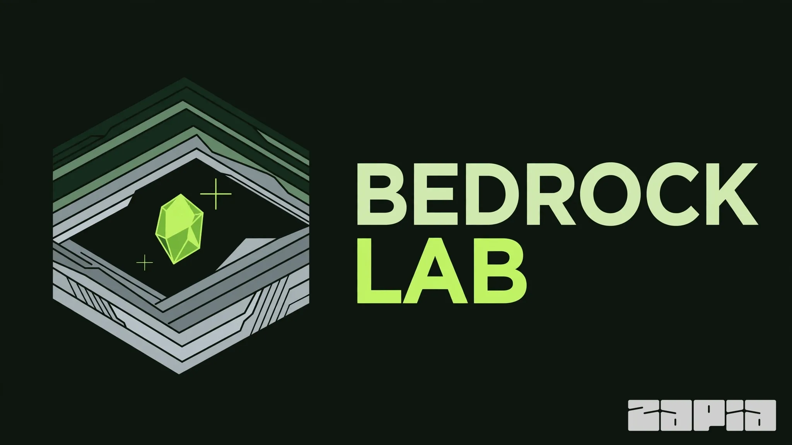
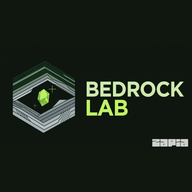

<div align="center">



<br>

# BEDROCK LAB

### El punto de encuentro para descubrir contenido de Minecraft Bedrock.

Explora addons, texturas, mapas y skins desde un catálogo que reúne distintas fuentes en una sola experiencia.

<br>

<a href="https://bedrock-lab-memeviod.onrender.com/">
  
</a>
<a href="https://github.com/memeviod/bedrock-lab/releases">
  
</a>
<a href="https://github.com/memeviod/bedrock-lab/issues">
  
</a>

<br><br>


</div>

---

## Sobre el proyecto

**Bedrock Lab** es un catálogo creado para hacer más sencillo el descubrimiento de contenido para **Minecraft Bedrock**. Reúne publicaciones de distintas plataformas y las presenta en una interfaz centralizada, desde la que puedes buscar, filtrar, consultar información y visitar las páginas originales.

El proyecto está disponible como sitio web y aplicación para Android. Su identidad visual conserva una estética oscura con acentos verdes, pensada para ofrecer una experiencia clara tanto en móviles como en escritorio.

## Explora el catálogo

<div align="center">

|  |  |  |  |
|:---:|:---:|:---:|:---:|
| **Addons** | **Texturas** | **Mapas** | **Skins** |
| Nuevas funciones | Cambios visuales | Mundos y aventuras | Apariencias |
</div>

## Funcionalidades

<table>
  <tr>
    <td width="50%">
      <h3>⌕ Búsqueda y filtros</h3>
      Encuentra publicaciones por nombre y organiza los resultados por categoría, fuente y versión.
    </td>
    <td width="50%">
      <h3>▦ Catálogo unificado</h3>
      Consulta contenido procedente de varias plataformas desde una sola interfaz.
    </td>
  </tr>
  <tr>
    <td>
      <h3>☆ Favoritos y recientes</h3>
      Guarda elementos y vuelve a consultar las publicaciones que has visitado. Los datos se conservan localmente en el navegador.
    </td>
    <td>
      <h3>↗ Detalles y enlaces</h3>
      Consulta la información disponible, comparte publicaciones y accede a sus páginas originales.
    </td>
  </tr>
  <tr>
    <td>
      <h3>文 Traducción</h3>
      Solicita la traducción automática de descripciones cuando la función está disponible.
    </td>
    <td>
      <h3>⚙ Herramientas</h3>
      Accede a la herramienta externa de conversión y a la guía de instalación.
    </td>
  </tr>
</table>

## Fuentes de contenido

Bedrock Lab integra cuatro plataformas del ecosistema de Minecraft Bedrock:

<div align="center">

<a href="https://www.curseforge.com/minecraft-bedrock">
  
</a>
<a href="https://mcpedl.com/">
  
</a>
<a href="https://modbay.org/">
  
</a>
<a href="https://www.mcpack.cc/">
  
</a>

</div>

| Fuente | Cómo se integra |
|---|---|
| **CurseForge** | Consulta de contenido mediante su API y gestión de descargas de archivos elegibles. |
| **MCPEDL** | Búsqueda y consulta de publicaciones mediante sus servicios y páginas públicas. |
| **ModBay** | Consulta de publicaciones disponibles en sus páginas públicas. |
| **McPack.cc** | Consulta del catálogo; dispone de un índice local de respaldo cuando la consulta en vivo no está disponible. |

La disponibilidad de resultados depende de cada plataforma. Si una fuente falla temporalmente, Bedrock Lab puede seguir mostrando resultados de las demás. Los datos de un índice de respaldo pueden no reflejar la publicación más reciente; comprueba siempre la información en el sitio original.

## Vista previa y acceso

<div align="center">

### BEDROCK LAB · WEB

<a href="https://bedrock-lab-memeviod.onrender.com/">
  
</a>

**[Visitar la experiencia web →](https://bedrock-lab-memeviod.onrender.com/)**

### BEDROCK LAB · ANDROID

Consulta las versiones disponibles y sus notas de publicación.

**[Ver descargas y versiones →](https://github.com/memeviod/bedrock-lab/releases)**

</div>

## Tecnología

| Tecnología | Responsabilidad |
|---|---|
| **HTML** | Estructura de la interfaz web. |
| **CSS** | Identidad visual, componentes y diseño adaptable. |
| **JavaScript** | Interacciones, búsqueda, filtros y lógica del cliente. |
| **Node.js** | Servidor HTTP e integraciones con fuentes externas. |
| **CurseForge API** | Consulta de información de CurseForge. |
| **GitHub Actions** | Automatización de tareas del proyecto. |
| **Render** | Alojamiento de la versión web. |

### Estructura del repositorio

```text
bedrock-lab/
├── .github/
│   └── workflows/       # Automatizaciones
├── index.html           # Interfaz web
├── server.js            # Servidor e integraciones
├── package.json         # Configuración y comandos
├── manifest.json        # Metadatos de la aplicación web
├── brand.webp           # Identidad visual
├── icon-192.png         # Icono de la aplicación
├── icon-512.png         # Icono de alta resolución
└── mcpack-index.json    # Índice local de respaldo
```

## Ejecutar en local

### Requisitos

- [Node.js 18 o superior](https://nodejs.org/)
- Git
- Una clave de API de CurseForge para habilitar las consultas que la requieren.

### 1. Clonar el repositorio

```bash
git clone https://github.com/memeviod/bedrock-lab.git
cd bedrock-lab
```

### 2. Configurar la clave de CurseForge

La clave se lee desde la variable de entorno `CURSEFORGE_API_KEY`.

**Linux / macOS**

```bash
export CURSEFORGE_API_KEY="TU_API_KEY"
```

**Windows PowerShell**

```powershell
$env:CURSEFORGE_API_KEY="TU_API_KEY"
```

No guardes claves privadas en el código fuente ni las publiques en GitHub.

### 3. Instalar e iniciar

```bash
npm install
npm start
```

El servidor escucha en el puerto definido por `PORT` o, si no se especifica, en el puerto predeterminado `3000`.

## API del servidor

| Método | Ruta | Propósito |
|---|---|---|
| `GET` | `/api/search` | Busca contenido en las fuentes disponibles. |
| `GET` | `/api/details` | Obtiene información ampliada de una publicación. |
| `GET` | `/api/download` | Gestiona descargas elegibles de CurseForge o redirige a la publicación original. |
| `GET` | `/manifest.json` | Entrega los metadatos de la aplicación web. |

Los parámetros y las respuestas se definen en `server.js`.

## Rendimiento y confiabilidad

El servidor incorpora mecanismos para administrar las solicitudes y limitar trabajo innecesario:

- Consultas concurrentes a distintas fuentes.
- Caché temporal para determinadas respuestas.
- Límites de concurrencia y tamaño de solicitudes.
- Tiempos máximos para conexiones externas.
- Cancelación y gestión de solicitudes que dejan de ser necesarias.
- Carga diferida de imágenes en la interfaz.
- Búsqueda con espera breve antes de consultar el servidor.

Estas medidas ayudan a controlar el funcionamiento del servicio. El consumo real de recursos depende del tráfico, de las respuestas de los proveedores externos y de la infraestructura de alojamiento.

## Contenido de terceros

Bedrock Lab facilita el descubrimiento de publicaciones externas. Los addons, mapas, texturas, skins, imágenes y demás recursos pertenecen a sus respectivos autores y titulares.

**Bedrock Lab no reclama la propiedad de esos contenidos.** Para verificar compatibilidad, permisos, créditos, disponibilidad o descargar un recurso, consulta siempre su publicación original.

## Reportar un problema

¿Encontraste un error o tienes una sugerencia?

<a href="https://github.com/memeviod/bedrock-lab/issues">
  
</a>

Al reportar un problema, incluye los pasos para reproducirlo, la sección o fuente afectada y la versión de tu navegador o aplicación. No publiques claves API, contraseñas ni tokens.

## Créditos

<div align="center">

### Dirección del proyecto

**MEMEVIOD**

### Reconocimiento especial

**Zapia**

Su contribución representa más del **80 % del desarrollo de Bedrock Lab**. Su trabajo ha sido fundamental para construir este proyecto.

</div>

---

<div align="center">


### BEDROCK LAB

**Descubre más. Explora Minecraft Bedrock.**

[Website](https://bedrock-lab-memeviod.onrender.com/) · [Repository](https://github.com/memeviod/bedrock-lab) · [Releases](https://github.com/memeviod/bedrock-lab/releases)

<sub>Un proyecto de MEMEVIOD · Con el apoyo de Zapia</sub>

</div>
